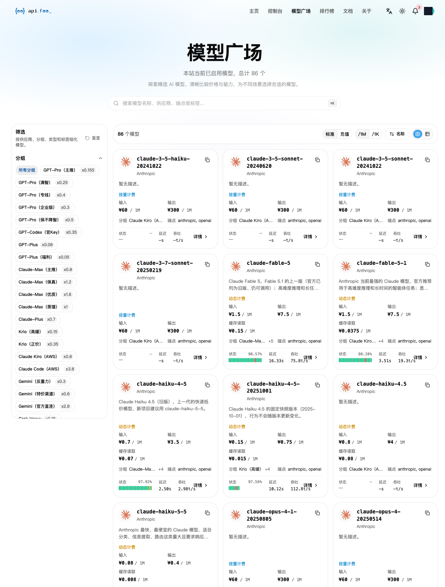
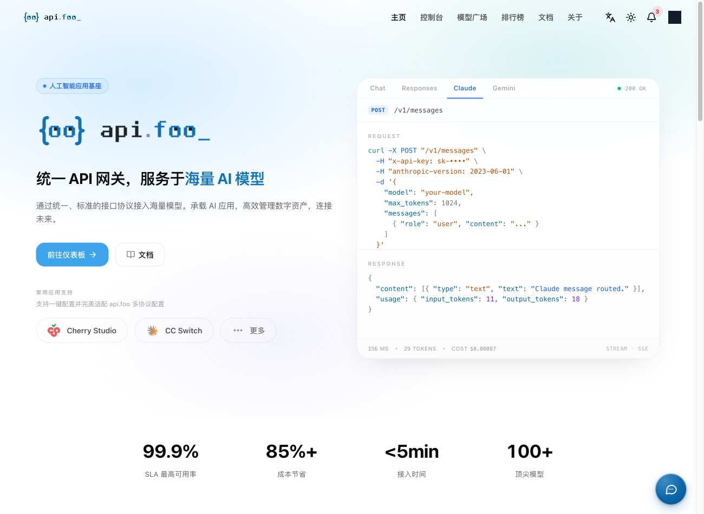
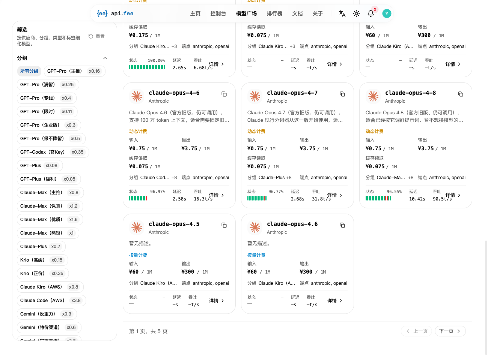
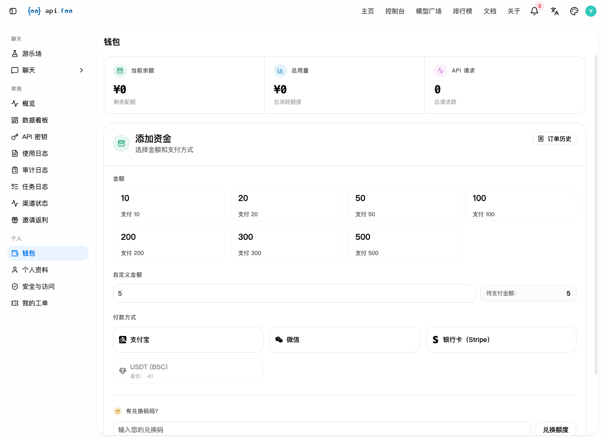
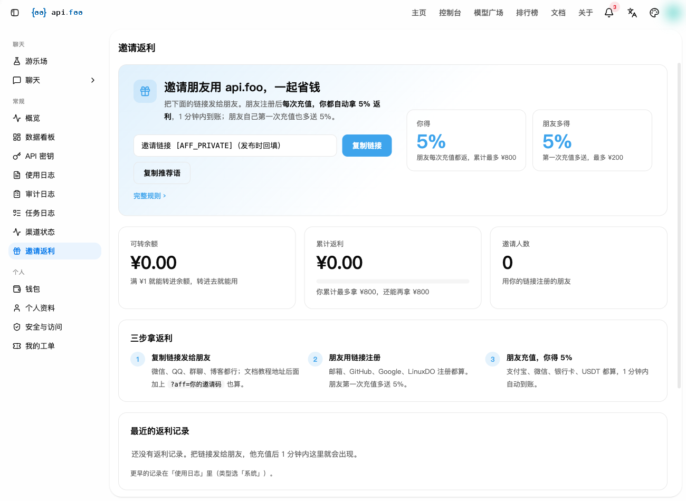

# api.foo 选购与计费指南：模型目录、42 个分组与充值前要核对的成本

> **利益披露：**本文含 api.foo 推广链接，经链接注册或充值，我们可能获得佣金。价格与分组以结算页面为准，本文不承诺最低价。

> **本文核对的范围：**本文核对的是**页面目录、价格、注册与返利规则**；本站**未充值、未调用模型、未测试提现**。型号名称和监控值均由**站方展示**，本文**未核实官方映射或实际后端身份**。

**Claude Code / Codex 能不能接、一次任务大概多少钱、充值怎么充不亏——按你实际会问的顺序，拆给你看。**

> ### 👉 注册 api.foo（本站邀请链接，符合规则的新人首充获 5% 额度，上限 ¥200）
>
> **[注册 api.foo](https://api.foo/sign-up?aff=J8aF)**
>
> 这是我们的邀请链接：用它注册，你自己首次充值时站方会多送 5% 额度（上限 ¥200），我们则拿到返利。规则以结算页为准。**注册后进入控制台。**
>
> 想先看价再决定：**[api.foo 定价页（同一邀请参数）](https://api.foo/pricing?aff=J8aF)** ｜ **[api.foo 接入文档（同一邀请参数）](https://api.foo/docs/?aff=J8aF)**

| 你要做的事 | 结论 | 去哪看 |
|---|---|---|
| **接 Claude Code / Codex** | 广场里 Claude 系标 `anthropic` 端点、GPT/Codex 系标 `openai` 端点，协议对得上；工具端到端跑通需你自己发一条请求验证 | [看端点分布](#一能力86-个模型112-截图--两类端点) |
| **算一次任务多少钱** | Claude 输入价 ¥0.08 ~ ¥60/1M，输出价是输入的 4~5 倍；缓存读取单独计价 | [看真实单价](#21-单价claude-系列实际价目) |
| **担心选错分组多花钱** | 页面 41 个已标价分组的倍率为 x0.015 至 x3.8（另有 default 未标）；两端涉及不同模型/计费类型，**不能推成同任务相差 250 倍**。先选择具体模型与分组，核对输入、输出、缓存或按次价格；所有分组视图的卡价不保证属于首个组 | [看完整倍率表](#22-倍率42-个分组x0015-到-x38) |
| **担心钱要不回来** | 预设 10–500 元；自定义栏曾填 5 并显示待付 5，但**本站未下单验证最低充值或支付成功**。实际以所选支付方式校验为准（USDT 页面标最低 40）。**未使用余额能否退款，页面没写——买之前先问客服** | [看充值前必问](#三充值前必须知道的四件事) |

---

## 目录

- [一、能力：86 个模型（11-02 截图）+ 两类端点](#一能力86-个模型112-截图--两类端点)
- [二、价格：先看单价，再看倍率](#二价格先看单价再看倍率)
- [三、充值前必须知道的四件事](#三充值前必须知道的四件事)
- [四、怎么小额试、怎么止损](#四怎么小额试怎么止损)
- [附录：完整分组倍率表 · 型号清单 · 核验与变动记录](#附录)

---

## 一、能力：86 个模型（11-02 截图）+ 两类端点

模型广场分 5 页、每页 20 张卡。**模型数以 2026-11-02 的截图为准：当屏显示 86 个**（同一份 11-02 数据按唯一 ID 去重得 81 个，两数差别来自统计口径，模型上下架本来就会动，本文不把它当成一个固定值）。分组数是 **2026-11-03 实抓的 42 个**（见附录倍率表）。⚠️ 我们没有拿到 11-03 的逐项模型清单，所以**本文不把 11-03 的模型总数写成精确数**。

覆盖面上值得你关心的几条：

- **Claude 系列**：3.5-haiku、3.5-sonnet、3.7-sonnet、fable-5、fable-5-1、haiku-4-5、haiku-4-5-20251001、haiku-5-5、opus-4-1、opus-4-4、opus-4-5、opus-4-5-20251101、opus-4-6、opus-4-7、opus-4-8，以及 thinking 版本
- **GPT 系列**：GPT-Pro / GPT-Plus / GPT-Codex 三条线，各自还细分为多个分组
- **别家也有**：Gemini、Grok、DeepSeek、智谱、Kimi、MiniMax
- **生图有专组**：gpt-image-2 / 2.5 系列、gemini 香蕉系、grok-imagine，各自独立分组

*图注：模型广场全貌——分 5 页，右侧每张卡直接给出输入/输出/缓存读取单价，以及状态、延迟、吞吐三项指标；左侧筛选栏就是分组筛选。⚠️ **这张图是 2026-11-02 的快照，屏上显示 86 个模型**；正文的 **42 个分组**是 **2026-11-03 实抓**的数字（分组筛选栏另有一张 11-03 的图）。模型数会随上下架变动，引用前请以页面为准。*

*图注：api.foo 首页。代码框按 Chat / Responses / Claude / Gemini 四个协议给调用示例；底部四个数字是**站方口径**（100+ 顶尖模型、99.9% SLA、85%+ 成本节省、<5min 接入），本文不用它们替任何结论背书。*

> **👉 先看价再决定**：[打开 api.foo 定价页搜你的型号](https://api.foo/pricing?aff=J8aF) —— 搜不到就不用往下看了；搜得到就看它的单价、分组、状态、延迟四项。（同一邀请参数）

**每张模型卡自带体检数据**——不用点进详情页，单价、可用率、延迟、吞吐都在卡上：

| 模型 | 状态 | 延迟 | 吞吐 | 单价（输入/输出） |
|---|---|---|---|---|
| claude-haiku-5-5 | 100.00% | 15.33s | 97.51 t/s | ¥0.08 / ¥0.4 |
| claude-fable-5 | 98.57% | 16.33s | 75.8 t/s | ¥1.5 / ¥7.5 |
| claude-fable-5-1 | 98.28% | 3.51s | 19.3 t/s | ¥1.5 / ¥7.5 |
| claude-opus-4-6 | 96.97% | 2.58s | 16.3 t/s | ¥0.75 / ¥3.75 |
| claude-opus-4-7 | 96.77% | 2.68s | 31.8 t/s | ¥0.75 / ¥3.75 |
| claude-opus-4-8 | 96.55% | 10.42s | 90.5 t/s | ¥0.75 / ¥3.75 |

⚠️ **这三项指标怎么读**：状态是页面展示的可用率，延迟是页面展示的延迟值（**统计口径站方未标注**，不等于你家的体感）。**表中数值均为站方页面展示值**。比如 opus-4-6、4-7、4-8 单价完全相同（¥0.75/¥3.75），站方延迟展示值分别是 2.58s、2.68s、10.42s——但**样本、时间段和统计方式未公开，不能据此断言哪个型号更快**；仅作为小额实测的候选线索，以你同一任务的实际响应与账单比较。

### 端点怎么对上你的工具

每张卡右下角标着这个模型走哪些端点，广场里能看到 `anthropic` 和 `openai` 两类：

| 你的用法 | 对应端点 | 页面上的依据 |
|---|---|---|
| **Claude Code** | `anthropic`（/v1/messages） | Claude 系列卡片标 anthropic |
| **Codex** | `openai`（/v1/chat/completions、/v1/responses） | GPT/Codex 系列卡片标 openai |
| **自己写脚本** | 两个都行 | 首页代码框四个协议示例 |
| **Workbuddy / 其他第三方客户端** | 页面无该客户端标注 | 公开页不提供 ⇒ **未知**，本文不断言其可用 |

> **👉 [查看接入说明与文档](https://api.foo/docs/?aff=J8aF)**

⚠️ **端点对得上 ≠ 工具端到端跑通**。工具版本、模型 ID 映射、工具调用和流式输出是否正常，页面不提供答案——真跑通要你自己发一条请求验证。

---

## 二、价格：先看单价，再看倍率

### 2.1 单价：Claude 系列实际价目

（页面口径 2026-11-03，单位 ¥/1M token）

| 模型 | 输入 | 输出 | 缓存读取 |
|---|---|---|---|
| claude-haiku-5-5 | **¥0.08** | ¥0.4 | ¥0.008 |
| claude-haiku-4-5-20251001 | **¥0.15** | ¥0.75 | ¥0.015 |
| claude-fable-5 / fable-5-1 | ¥1.5 | ¥7.5 | ¥0.15 / ¥0.0375 |
| claude-haiku-4-5 | ¥0.7 | ¥3.5 | ¥0.07 |
| claude-opus-4-6 / 4-7 / 4-8 | **¥0.75** | ¥3.75 | ¥0.075 |
| claude-3-5-haiku / 3-5-sonnet / 3-7-sonnet | ¥60 | ¥300 | — |

**先看输出价**：Claude 系列输出普遍是输入的 **4~5 倍**（haiku-5-5 是 5 倍，opus 系是 5 倍）。输入和输出各占多少，取决于你的任务——写代码、改文件、跑 agent 这类场景输出通常占比不低，但本文没有真实用量记录，不替你估比例。

**再注意最后一行**：3.5-haiku、3.5-sonnet、3-7-sonnet 是 ¥60/¥300，比 fable-5 的 ¥1.5/¥7.5 贵 40 倍。同一站同一协议，老型号贵这么多，原因本文未核实（可能是分组和渠道不同），但结论明确：**"这站贵不贵"没有意义，有意义的是"你要用的那个型号在这站什么价"**。

> **👉 [核对你要用的那个型号的单价与分组](https://api.foo/pricing?aff=J8aF)**

### 2.2 倍率：42 个分组，x0.015 到 x3.8

*图注：定价页部分分组与倍率示例（2026-11-03）；画面不包含完整42组清单，也不作为倍率全区间的图证。完整清单与倍率见附录。两端涉及不同模型与计费类型，不代表同任务价格差。*

**怎么用这张表**：页面 **41 个已标价分组的倍率为 x0.015 至 x3.8**（另有 default 未标）；**两端涉及不同模型/计费类型，不能推成同任务相差 250 倍**。先选择具体模型与分组，核对输入、输出、缓存或按次价格；**所有分组视图的卡价不保证属于首个组**。

完整清单见 [附录](#附录)，最低的几档：

| 分组 | 倍率 | 分组 | 倍率 |
|---|---|---|---|
| gpt-image-2（生图） | x0.015 | Grok Heavy | x0.18 |
| gpt-image-2.5（生图） | x0.015 | GPT-Pro（主推） | x0.16 |
| gpt-image-2.5（超分） | x0.02 | GPT-Pro（限时） | x0.11 |
| gpt-image-2-pro（生图） | x0.1 | Krio（高缓） | x0.15 |
| grok-imagine-image-2.0（生图） | x0.05 | GPT-Plus（福利） | x0.05 |
| gemini 香蕉系三个 | x0.06 | GPT-Plus | x0.08 |

⚠️ **分组名是站方取的，含义以站方说明为准**——"保真""优质""保不降智""官方直连"是站方命名，本文不替它们背书也不替它们解释成某种质量保证。你能确定的是**倍率数字**，不能确定的是**名字背后的承诺**。

### 2.3 充值前要核对的计费四项

一次真实支出要核对的不是一条公式，而是这几层关系页面没写死。**充值前逐项确认**：

1. **所选分组的最终单位价是否已含倍率** —— 含了就别再乘一次；
2. **缓存 tokens 与输入 tokens 的计数是否重叠** —— 重叠的部分会重复计费；
3. **站内余额与实付的换算关系** —— "¥"是站内展示价还是实际人民币，充值时有没有兑换或优惠。

这三条没核清之前，任何"到官方价几折"的说法都别信——包括站方首页那个 85% 成本节省。**核完再用首条小额请求逐项对账**，按该口径估算；**未确认前不报实际总价**。

---

## 三、充值前必须知道的四件事

*图注：充值页。固定档位 10 到 500，自定义金额栏示例填的是 5；支付方式列了支付宝、微信、Stripe 银行卡、USDT(BSC)。USDT 那行下面写着"最低 40"——这条限制容易被忽略。*

**① 支付方式**：支付宝、微信、Stripe 银行卡、USDT(BSC)。USDT 最低充 40。

**② 邀请返利**：站方规则页写明，好友每次充值你得 5%（1 分钟内到账，累计上限 ¥800），好友首次充值多送 5%（上限 ¥200），返利满 ¥1 可转站内余额，现金提现走支付宝或微信、**没有最低金额**，人工核对后 1 个工作日内到账；好友退款会扣回对应返利。

*图注：邀请返利页。链接一栏就是上面那个注册链接用的本站自有推广码（**图中该处为脱敏标记**，实际入口见正文）。*

**③ 页面没写、但直接影响你钱的四条**——建议直接问客服（几秒钟的事）：
- 未使用的余额能不能退、怎么申请、多久到账
- 提示词、代码、文件、密钥会不会被记录、留多久
- 限流和并发上限按什么维度算（账号 / Key / 分组）
- 服务中断时的历史状态记录和补偿口径

**④ 注册踩过的两个点**（省你排查时间）：没收到验证码先查垃圾箱（我们的首封验证码就进了 Junk，而且是字母数字混合）；模型广场别按首屏数卡片，首屏只有 20 张，5 页去重后才是完整清单。

---

## 四、怎么小额试、怎么止损

1. **先逛模型广场**（不是首页）：搜你的型号，看单价、当前分组倍率、状态、延迟
2. **建 Key 后选对端点**：Claude Code 走 `anthropic`，Codex 走 `openai`
3. **充值页面最小档先来一次**：把预算卡死在你要试的那个任务量上
4. **发一条你自己的真实请求**，然后去控制台看三处：用量概览（余额/用量/请求数）、使用日志（每条请求的 token 和扣费）、渠道状态
5. **对账**：控制台扣的费用和你按单价算的差多少？**对不上就先停**，保存用量与扣费记录，核对分组、倍率和余额换算关系，查清原因再决定要不要继续——别在原因不明时接着充
6. **不值就撤**：这次额度用完就停，不要因为"已经充了"而继续

控制台能看到余额、用量、请求数三条线，以及数据看板、使用日志、审计日志、渠道状态这几页。

---

## 最后

api.foo 的模型货架和分组体系是它真正的竞争力，也是它真正的门槛：**它是给愿意读懂价目表的人准备的。** 86 个模型（11-02 截图）、42 个分组（11-03 实抓）、每个模型带状态/延迟/吞吐和缓存价——这套信息密度集中在一页里；代价是在"选哪个分组"这一步吃暗亏。

**可先按所选支付方式的最低充值要求，小额测试一次真实任务，再核对扣费。**

**👉 [注册 api.foo（本站邀请链接，符合规则的新人首充获 5% 额度，上限 ¥200）](https://api.foo/sign-up?aff=J8aF)** —— **注册后进入控制台**。（价格与分组以页面当前口径为准，文中数字核验于 2026-11-03）

---

## 附录

<b>完整分组倍率表（42 个 · 2026-11-03 实抓）</b>

| 分组 | 倍率 | 分组 | 倍率 |
|---|---|---|---|
| gpt-image-2（生图） | x0.015 | GPT-Plus | x0.08 |
| gpt-image-2.5（生图） | x0.015 | GPT-Pro（限时） | x0.11 |
| gpt-image-2.5（超分） | x0.02 | Krio（高缓） | x0.15 |
| grok-imagine-image-2.0（生图） | x0.05 | GPT-Pro（主推） | x0.16 |
| GPT-Plus（福利） | x0.05 | Grok Heavy | x0.18 |
| gemini-3-pro-image（香蕉生图） | x0.06 | GPT-Pro（满智） | x0.25 |
| gemini-3.1-flash-image（香蕉生图） | x0.06 | Zhipu（福利） | x0.25 |
| gemini-nano-banana-2.1（香蕉生图） | x0.06 | GPT-Pro（企业版） | x0.3 |
| gpt-image-2-4k（生图） | x0.08 | Gemini（反重力） | x0.3 |
| gpt-image-2-pro（生图） | x0.1 | GPT-Codex（官Key） | x0.35 |
| gpt-image-2.5-4k（生图） | x0.12 | Krio（正价） | x0.35 |
| GPT-Pro（专线） | x0.4 | Deepseek（优质） | x0.5 |
| Kimi | x0.4 | GPT-Pro（保不降智） | x0.5 |
| Claude-Plus | x0.7 | DeepSeek（精选） | x0.6 |
| Gemini（特价渠道） | x0.6 | Grok（企业版） | x0.7 |
| Claude-Max（主推） | x0.8 | Claude Kiro (AWS) | x0.8 |
| MiniMax | x0.8 | Claude-Max（蒸馏） | x1 |
| DeepSeek（官方直连） | x1 | Claude-Max（保真） | x1.2 |
| Claude-Max（优质） | x1.6 | Gemini（官方直连） | x2.8 |
| Zhipu（优质） | x0.5 | gpt-image-2（稳定） | x0.03 |
| Claude Code (AWS) | x3.8 | default | 无标注 |

<b>站方展示的全部 Claude 型号（广场 5 页去重）</b>

claude-3-5-haiku-20241022 · claude-3-5-sonnet-20241022 · claude-3-5-sonnet-20240620 · claude-3-5-sonnet-20241219 · claude-3-7-sonnet-20250219 · claude-fable-5 · claude-fable-5-1 · claude-haiku-4-5 · claude-haiku-4-5-20251001 · claude-haiku-5-5 · claude-opus-4-1 · claude-opus-4-1-20250805 · claude-opus-4-4 · claude-opus-4-4-20250514 · claude-opus-4-5 · claude-opus-4-5-20251101 · claude-opus-4-5-thinking · claude-opus-4-6 · claude-opus-4-7 · claude-opus-4-8

型号名称为**站方展示名**；与官方型号的对应关系、以及实际后端身份本文未核实。

<b>本文怎么核的 & 什么没核 · 变动记录</b>

**核过**（有截图或实抓记录）：模型广场完整清单与页数、每张模型卡的单价/缓存价/状态/延迟/吞吐、42 个分组的完整名称与倍率、充值页金额档位与支付方式、邀请返利规则页原文、注册流程细节（29 号浏览器实操）。

**没核**（所以本文没说）：工具端到端兼容性（Claude Code / Codex 的模型 ID 映射、工具调用、流式输出）、单价与倍率的相乘关系、充值兑换比例、退款与售后细则、数据保留策略、发票与对公能力、模型后端身份与是否降级。

**变动记录**：
- 2026-11-02 首版核到 86 个模型（截图可见）、20 个可见分组
- 2026-11-03 复核：**42 个分组**（逐项实抓，含倍率）；⚠️ 当日未取到可独立重算的模型逐项清单，**模型数不在此声明为精确值**；GPT-Pro（主推）倍率由 x0.155 调整为 x0.16；新增 GPT-Pro（限时）x0.11、Grok / DeepSeek / 智谱 / Kimi / MiniMax / 生图系列分组
- ⛔ 这类数字会随站方调整变化，引用前请以页面为准

<small>事实边界：本文价格、模型清单、分组倍率、支付方式、返利规则均来自 api.foo 公开页面，核验日期 2026-11-03。模型卡上的状态/延迟/吞吐为站方展示值。本文含推广链接，充值会产生佣金。</small>
